<div align="center">

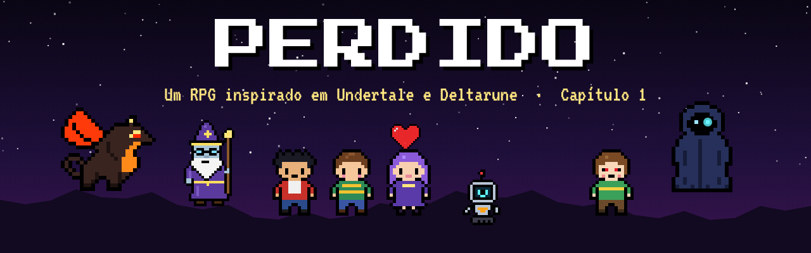

<br>

<a href="https://github.com/heitorcoser/losters/releases/latest"></a>
<a href="https://github.com/heitorcoser/losters/releases"></a>


### Um RPG em pixel art inspirado em **Undertale** e **Deltarune**.
Você caiu num mundo debaixo da terra. Faça amigos, poupe (ou não) os monstros,<br>
encontre um dragão, enfrente o Mestre Encapuzado... e descubra para onde você vai.

<br>

<a href="https://heitorcoser.github.io/Losters/jogar/"></a>
&nbsp;
<a href="https://github.com/heitorcoser/losters/releases/latest/download/Perdido.apk"></a>
&nbsp;
<a href="https://github.com/heitorcoser/losters/releases/latest/download/Perdido-Setup.exe"></a>

<br><br>

**[🎮 Sobre](#sobre)** &nbsp;·&nbsp;
**[⬇️ Baixar](#baixar)** &nbsp;·&nbsp;
**[🕹️ Controles](#controles)** &nbsp;·&nbsp;
**[👥 Multiplayer](#multiplayer)** &nbsp;·&nbsp;
**[📖 História](#historia)** &nbsp;·&nbsp;
**[🧑‍🤝‍🧑 Personagens](#personagens)** &nbsp;·&nbsp;
**[🛠️ Desenvolvimento](#desenvolvimento)**

</div>

---

<a id="sobre"></a>
## 🎮 Sobre o jogo

**PERDIDO** é um jogo 2D no estilo de Undertale, feito para celular e PC. Batalhas em que você desvia com a sua **ALMA**, escolhas que mudam a história (**Pacifista**, **Neutra** ou **Genocida**), um **dragão parceiro** que evolui, um **grupo** de amigos que luta do seu lado e **multiplayer cooperativo** entre PC e celular.

<table>
  <tr>
    <td width="50%">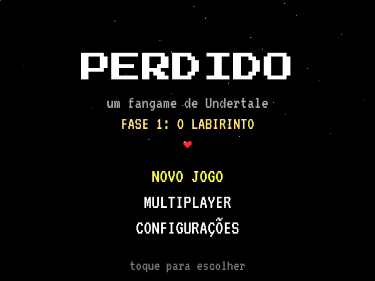</td>
    <td width="50%">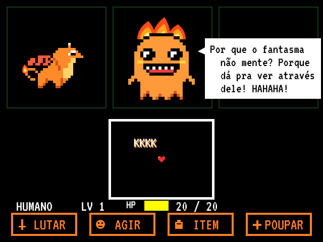</td>
  </tr>
  <tr>
    <td align="center"><sub><b>Tela de título</b></sub></td>
    <td align="center"><sub><b>Boss: FireGhost e suas piadas péssimas</b></sub></td>
  </tr>
  <tr>
    <td>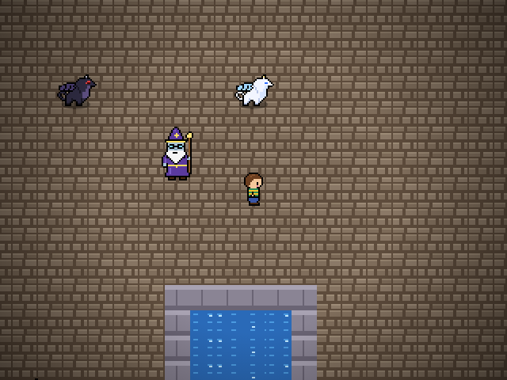</td>
    <td>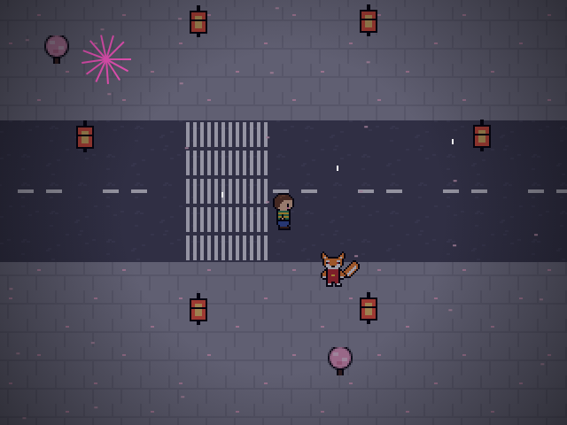</td>
  </tr>
  <tr>
    <td align="center"><sub><b>DragonCity: escolha seu dragão</b></sub></td>
    <td align="center"><sub><b>Neo-Sakura: o Festival das Lanternas</b></sub></td>
  </tr>
  <tr>
    <td>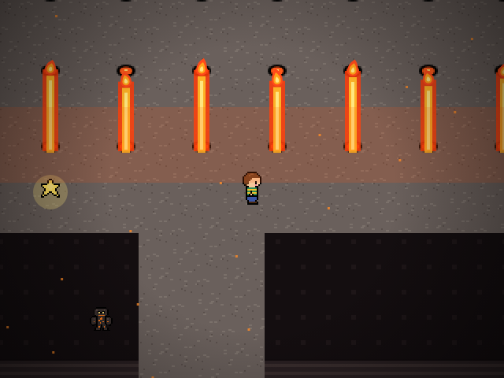</td>
    <td>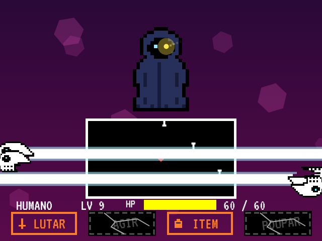</td>
  </tr>
  <tr>
    <td align="center"><sub><b>O Gigante Adormecido e seus gêiseres</b></sub></td>
    <td align="center"><sub><b>Boss: o Mestre Encapuzado</b></sub></td>
  </tr>
  <tr>
    <td>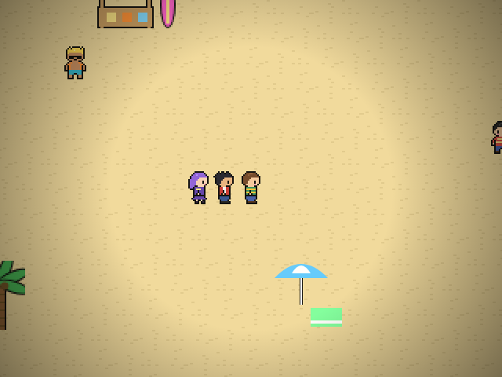</td>
    <td>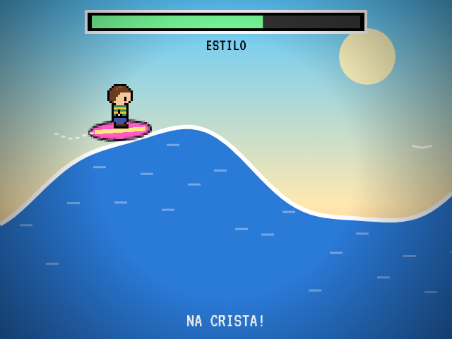</td>
  </tr>
  <tr>
    <td align="center"><sub><b>A praia, com Kai e Luna</b></sub></td>
    <td align="center"><sub><b>Minijogo de surfe</b></sub></td>
  </tr>
</table>

<table>
  <tr>
    <th>✨ Destaques</th>
    <th>📊 Números</th>
  </tr>
  <tr>
    <td>

- Batalhas no estilo Undertale: **LUTAR, AGIR, ITEM, POUPAR**
- 3 rotas que mudam diálogos e finais
- **Dragão parceiro** (3 tipos) que evolui no vulcão
- **Grupo** com Kai e Luna, como no Deltarune
- Puzzles, minijogos, cidades, festival e surfe
- Músicas originais com vários instrumentos
- Painel de **missões** com seta de objetivo
- **Atualização automática** no celular e no PC

</td>
    <td>

| | |
|---|---|
| Fases | **14** (Capítulo 1) |
| Chefes | **10+** |
| Personagens | **40+** |
| Músicas | **45+** |
| Plataformas | Android · Windows |
| Jogadores | 1 a **4** (co-op) |

</td>
  </tr>
</table>

---

<a id="baixar"></a>
## ⬇️ Baixar e instalar

| | Plataforma | Arquivo | Como instalar |
|:---:|---|---|---|
| 🌐 | **Navegador** (PC ou celular) | [**Jogar agora**](https://heitorcoser.github.io/Losters/jogar/) | Não precisa instalar nada. Site: [heitorcoser.github.io/Losters](https://heitorcoser.github.io/Losters/) |
| 📱 | **Android** 7.0 ou mais | [**Perdido.apk**](https://github.com/heitorcoser/losters/releases/latest/download/Perdido.apk) | Baixe e abra o arquivo. Se o Android pedir, permita **instalar apps de fontes desconhecidas**. |
| 💻 | **Windows 10 / 11** | [**Perdido-Setup.exe**](https://github.com/heitorcoser/losters/releases/latest/download/Perdido-Setup.exe) | Abra o instalador: ele instala e já abre o jogo. Se aparecer *"o Windows protegeu o computador"*, clique em **Mais informações → Executar assim mesmo**. |

> [!TIP]
> **O jogo se atualiza sozinho.** Quando sai uma versão nova, ele avisa ao abrir e instala com um toque. O seu save continua salvo.

Todas as versões ficam na página de **[Lançamentos](https://github.com/heitorcoser/losters/releases)**.

---

<a id="controles"></a>
## 🕹️ Controles

| Ação | 📱 Celular | 💻 Teclado |
|---|---|---|
| Andar / mover nos menus | Analógico (ou direcional) | **Setas** / **WASD** |
| Confirmar / falar | Botão **A** ou tocar na tela | **Z** / **Enter** |
| Cancelar / abrir o menu | Botão **B** ou *voltar* do Android | **X** / **Esc** |
| Mover a ALMA na batalha | Analógico ou arrastar o dedo | **Setas** |
| Pular com a alma azul | Analógico para cima ou segurar **A** | **Seta para cima** |
| Tela cheia | — | **F11** |

<details>
<summary><b>💡 Dicas</b></summary>

<br>

- Em **CONFIGURAÇÕES** (tela inicial ou menu B) dá para trocar entre **analógico** e **direcional**, e ligar ou desligar música, efeitos e o painel de missões.
- O objetivo atual aparece no canto da tela, com uma **seta amarela** apontando para onde ir. Também dá para ver em **menu B → MISSÃO**.
- As **estrelas** salvam o jogo e recuperam todo o seu HP.
- **Ossos azuis**: fique parado. **Ossos laranjas**: continue se mexendo.

</details>

---

<a id="multiplayer"></a>
## 👥 Multiplayer cooperativo

**PC e celular jogam juntos, pela internet, sem VPN.** Até **4 jogadores**.

<table>
  <tr>
    <th width="50%">👑 Quem cria a sala</th>
    <th width="50%">🙋 Quem entra</th>
  </tr>
  <tr>
    <td>

1. No título, toque em **MULTIPLAYER** (ou no jogo: **B → MULTI**).
2. Toque em **CRIAR SALA**.
3. Passe o **código** (ex.: `B9V94`) para os amigos.
4. Jogue a história normalmente.

</td>
    <td>

1. Abra o jogo no PC ou no celular.
2. Vá em **MULTIPLAYER**.
3. Digite o seu nome e o **código**.
4. Toque em **ENTRAR**.

</td>
  </tr>
</table>

- Os amigos veem a tela de quem criou a sala, andam com o **próprio personagem** no mapa e desviam com a **própria alma** (colorida) nas batalhas. Eles também ouvem as músicas e os sons.
- O **HP é do grupo todo**: se alguém for atingido, todo mundo perde vida.

### 🔥 Quanto mais jogadores, mais difícil

| Jogadores | Vida do inimigo | Força do inimigo | Velocidade dos ataques |
|:---:|:---:|:---:|:---:|
| 1 | normal | normal | normal |
| 2 | **+60%** | **+1** | **+30%** |
| 3 | **+120%** | **+2** | **+60%** |
| 4 | **+180%** | **+3** | **+90%** |

<details>
<summary><b>🔌 Como a conexão funciona</b></summary>

<br>

A conexão é direta entre os aparelhos (**WebRTC**). Um servidor gratuito do PeerJS só ajuda os aparelhos a se encontrarem pelo código. Quando a rede não deixa conectar direto (algumas redes 4G, por exemplo), a conexão passa por um servidor de repasse gratuito. Por isso não precisa de VPN nem de configurar o roteador.

Algumas lutas da história são **1 contra 1** (como contra o Mestre Encapuzado): nelas, os amigos só assistem.

</details>

---

<a id="historia"></a>
## 📖 História — Capítulo 1

> [!WARNING]
> **Spoilers!** Abra cada fase só depois de jogar.

<details>
<summary><b>🌿 Fase 1 — O Labirinto</b></summary>

<br>

- **Cutscene**: você passeia pela floresta, se perde e cai num buraco.
- **Instrutor**: velho mago-monstro que te acolhe, ensina a lutar e entra no seu grupo.
- **Tutorial**: batalha contra o Boneco (LUTAR, AGIR, ITEM, POUPAR e desviar).
- **Labirinto**: corredores com musgo e encontros aleatórios com o **Musgolho** e o **Fantasminha**.
- **Ajuda do Instrutor** (AGIR): `Instr: Magia` (dano) e `Instr: Acalmar` (piedade). Ele te cura se o HP ficar baixo.

</details>

<details>
<summary><b>🐉 Fase 2 — DragonCity</b></summary>

<br>

- No **Ninho** você escolhe seu parceiro:
  - **Dragão Preto** (forte): +3 de ataque e *Investida* devastadora.
  - **Dragão Branco** (rápido): alma mais veloz e *Ventania*, que encurta o ataque inimigo.
  - **Dragão Laranja** (fogo): *Sopro de Fogo*, que queima o inimigo por 3 turnos.
- Você se esconde atrás das caixas e ouve o **FireGhost** e o **IceGhost** conversando.
- Mercado da Dona Escama, a missão do filhote perdido *Pipoca* e o **Bosque das Cinzas** com o quebra-cabeça das estátuas.
- **BOSS: FireGhost**, com 7 ataques e piadas que viram projéteis. Dá para vencer ou poupar rindo das piadas.

</details>

<details>
<summary><b>❄️ Fase 3 — Colônia de Gelo</b></summary>

<br>

- O **IceGhost** jura **vingança**.
- Um **estranho encapuzado** te entrega um **CELULAR** e some na neve. O **Treinador** te liga com dicas.
- Vila dos pinguins e uma sequência longa (e chata, de propósito) de puzzles: placas X/O, lago escorregadio, estalactites, blocos de gelo, Porta das Piadas e a ponte de gelo rachado.

</details>

<details>
<summary><b>🤖 Fase 4 — A Cidade Futurista</b></summary>

<br>

- Um **escorregador** dos fantasmas te joga na Cidade Futurista, onde você conhece o robô **BIT**.
- Tour pela cidade, cinema, dormir na casa do Bit e um dia de **escola**.
- **BOSS: Gangue dos Valentões** contra você, seu dragão e o Bit. `Bit: Música` cura HP.

</details>

<details>
<summary><b>🍬 Fase 5 — A Ilha dos Doces</b></summary>

<br>

> Esta fase é uma **crítica ao nazismo**. Ela mostra, sem violência gráfica, como a propaganda de "raça superior", a desumanização e a obediência cega levam à opressão, e como a solidariedade e a resistência podem vencer. Termina com um cartão de **memória** sobre o que aconteceu de verdade.

- Na ilha, os doces se dizem um "povo perfeito". Não-doces vão para o **campo de trabalho**.
- Seu nome vira o **Nº 4812**. Barra de **fome**, trabalho forçado, a fábrica e a chamada.
- Fuga noturna desviando das lanternas, a libertação e o **BOSS: Diretor Macaron Dourado**, que é preso para ser **julgado**.

</details>

<details>
<summary><b>🕷️ Fase 6 — A Caverna</b></summary>

<br>

- Aranhas e esqueletos, vizinhos há cem anos, entram em **guerra** por causa das mentiras dos irmãos fantasmas.
- O confronto na Toca Escura muda com a sua **rota**:
  - **Pacifista**: só conversa; vocês podem virar amigos.
  - **Neutra**: boss contra os dois irmãos.
  - **Genocida**: boss e um **ritual** que acaba com os fantasmas.
- E depois... **nada mudou**.

</details>

<details>
<summary><b>🌸 Fase 7 — Neo-Sakura</b></summary>

<br>

- Uma cidade parecida com Tóquio: cerejeiras, neon, torii e trens. A **Guardiã Kitsune** decide se os refugiados entram.
- Escola, konbini, ramen e o **Festival das Lanternas**.
- A guerra chega. Você não muda o mundo. **Fuja até o metrô** antes do tempo acabar.

</details>

<details>
<summary><b>🌋 Fase 8 — A Vila Vulcânica</b></summary>

<br>

- O **Mestre Draco** treina seu dragão: pontaria, voo e a prova contra o **Dragão Ancião**.
- Suba o **Gigante Adormecido**: gêiseres em ondas e pedras que afundam na lava.
- O **Coração do Vulcão** faz o dragão evoluir:
  - Laranja → **Dragão de Lava** (mais dano e queima mais forte)
  - Branco → **Dragão de Neve** (mais rápido e **congela** o inimigo)
  - Preto → **Dragão das Trevas** (dano altíssimo)
- O dragão aprende a **voar** e te leva embora.

</details>

<details>
<summary><b>💀 Fase 9 — O Mestre</b></summary>

<br>

- Vale Comum, uma cidade tranquila... e o **Mestre Encapuzado** esperando na ponte.
- **BOSS (1ª parte)**: ataque surpresa, botões **AGIR e POUPAR quebrados**, canhões de caveira, ossos azuis e laranjas, alma azul com gravidade e **KARMA**.
- Se o seu HP chegar a 1, ele para: *"quando estiver preparado, me encontre de novo"*.

</details>

<details>
<summary><b>🦁 Fase 10 — A Arena</b></summary>

<br>

- O **Mestre Leão** te mostra a verdadeira força de você mesmo: **agilidade**, **força** e a luta contra a sua própria **Sombra**.
- Você ganha a **Faca do Leão** (+6 de ataque) e +10 de HP máximo.

</details>

<details>
<summary><b>⚔️ Fase 11 — A Batalha</b></summary>

<br>

- No salão dourado: *"A batalha vai começar."*
- A luta de verdade, com tela de cabeça pra baixo, tempestade de canhões e o **ATAQUE FINAL**.
- Na rota pacifista, o botão POUPAR se reconstrói sozinho.

</details>

<details>
<summary><b>🏥 Fase 12 — A Vila das Espécies</b></summary>

<br>

- Você acorda no hospital da **Doutora Pena**.
- Na vila você conhece **Kai** e **Luna**, que entram no seu **grupo** para sempre:
  - `Kai: Golpe` · `Luna: Cura` · `Luna: Acalmar` · `Kai+Luna: Combo`

</details>

<details>
<summary><b>🏖️ Fase 13 — A Praia</b></summary>

<br>

- No píer, **Carmim**, a humana de olhos vermelhos. Na rota genocida ela te dá parabéns; nas outras, vocês lutam. Ela vai **coletar 6 almas**.
- O surfista **Kauã** te ensina a **surfar**, e o dia termina com diversão na praia.

</details>

<details>
<summary><b>🚪 Fase 14 — A Casa</b></summary>

<br>

- Uma casinha, dias tranquilos com o grupo... e uma **porta gigante** no porão.
- Do outro lado, uma estrada de neve e os **créditos do Capítulo 1**.

</details>

<br>

### ⚖️ Rotas

| Rota | Como conseguir | O que muda |
|---|---|---|
| 🕊️ **Pacifista** | Não derrotar ninguém | Amizades, finais mais bonitos, o POUPAR volta |
| ⚖️ **Neutra** | Qualquer outro caso | Mais chefes, menos amigos |
| 🔪 **Genocida** | 6+ derrotados e no máximo 2 poupados | O mundo tem medo de você |

> **CAPÍTULO 2: em breve.**

---

<a id="personagens"></a>
## 🧑‍🤝‍🧑 Personagens

<table>
  <tr>
    <td align="center">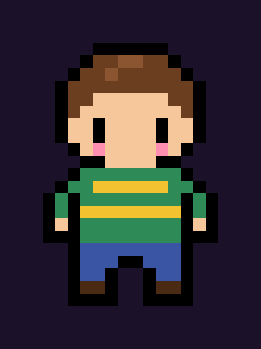<br><b>Você</b></td>
    <td align="center"><br><b>Instrutor</b></td>
    <td align="center">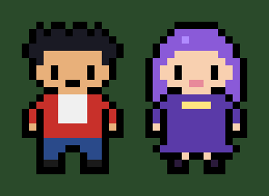<br><b>Kai e Luna</b></td>
    <td align="center">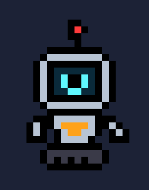<br><b>Bit</b></td>
  </tr>
  <tr>
    <td align="center"><br><b>Dragões evoluídos</b></td>
    <td align="center">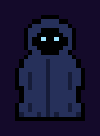<br><b>Mestre Encapuzado</b></td>
    <td align="center">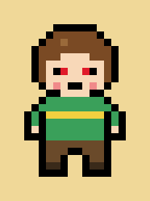<br><b>Carmim</b></td>
    <td align="center"><br><b>Guardiã Kitsune</b></td>
  </tr>
</table>

<details>
<summary><b>👀 Ver todos os personagens</b></summary>

<br>

<table>
  <tr>
    <td align="center"><br>FireGhost</td>
    <td align="center"><br>IceGhost</td>
    <td align="center"><br>Dragão Preto</td>
    <td align="center">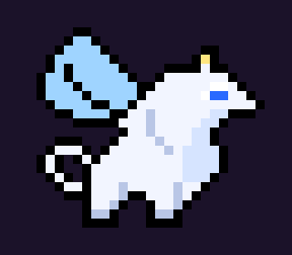<br>Dragão Branco</td>
    <td align="center"><br>Dragão Laranja</td>
  </tr>
  <tr>
    <td align="center">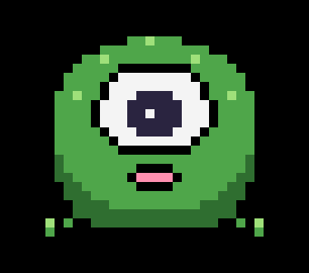<br>Musgolho</td>
    <td align="center">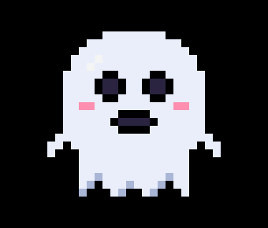<br>Fantasminha</td>
    <td align="center">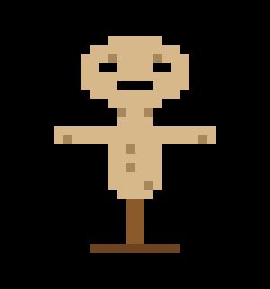<br>Boneco</td>
    <td align="center">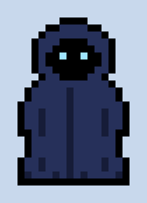<br>Encapuzado</td>
    <td align="center"><br>Pinguim Bravo</td>
  </tr>
  <tr>
    <td align="center">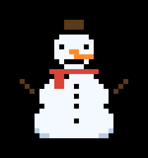<br>Nevoso</td>
    <td align="center"><br>Valentões</td>
    <td align="center"><br>Diretor Macaron</td>
    <td align="center">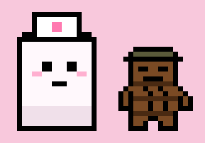<br>Marshmallow e Chocolate</td>
    <td align="center"><br>Capataz Pirulito</td>
  </tr>
  <tr>
    <td align="center">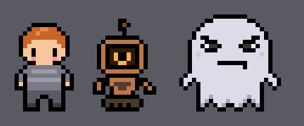<br>Lia, Ferrugem e Vovó</td>
    <td align="center"><br>Aranhas</td>
    <td align="center">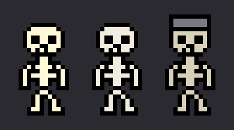<br>Esqueletos</td>
    <td align="center"><br>Mestre Draco</td>
    <td align="center">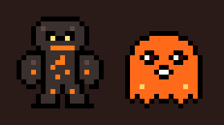<br>Golem e Fantasma de Lava</td>
  </tr>
  <tr>
    <td align="center">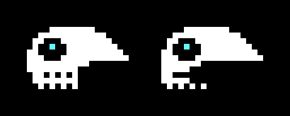<br>Canhão de Caveira</td>
    <td align="center">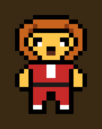<br>Mestre Leão</td>
    <td align="center">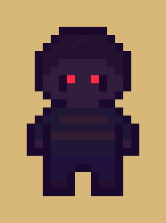<br>Sombra</td>
    <td align="center">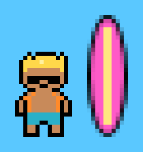<br>Kauã</td>
    <td align="center">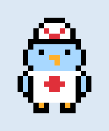<br>Doutora Pena</td>
  </tr>
</table>

Toda a arte é **pixel art original**, desenhada em código.

</details>

---

<a id="desenvolvimento"></a>
## 🛠️ Desenvolvimento

<details>
<summary><b>🚀 Como lançar uma versão nova</b></summary>

<br>

1. Aumente o `versionCode` (e o `versionName`) em `android/app/build.gradle`.
2. Escreva as novidades em `NOVIDADES.md`.
3. Faça push na `main`.

O GitHub Actions (`.github/workflows/lancamento.yml`) compila o **APK** e o **instalador do Windows** e cria o lançamento `v<versionCode>` com os dois arquivos. Os jogos já instalados encontram a versão nova sozinhos.

</details>

<details>
<summary><b>🧱 Compilar na mão</b></summary>

<br>

**Android**

```bash
cd android
./gradlew assembleRelease
# saída: app/build/outputs/apk/release/app-release.apk
```

**Windows (Electron)**

```bash
cp -r www pc/www
cd pc
npm install
npx electron-builder --win nsis --x64
# saída: dist/Perdido-Setup.exe
```

**Navegador**: dá para abrir `www/index.html` direto no Chrome ou no Edge.

</details>

<details>
<summary><b>📁 Estrutura do projeto</b></summary>

<br>

```
www/              o jogo (HTML5 Canvas + WebAudio)
  js/engine.js      controles, configurações, texto, diálogo, save
  js/world.js       motor do mapa (movimento, entidades, roteiros, grupo)
  js/battle.js      batalhas, dragões, grupo e ataques
  js/boss9.js       a luta contra o Mestre Encapuzado
  js/coop.js        multiplayer cooperativo (WebRTC / PeerJS)
  js/audio.js       efeitos e sequenciador de músicas
  js/sprites*.js    pixel art e tiles de cada fase
  js/phase1-14.js   as 14 fases do Capítulo 1
  js/quests.js      painel de missões e seta de objetivo
  js/main.js        título, cartões de fase, finais e créditos
  lib/peerjs.min.js PeerJS (licença MIT)
android/          app Android (WebView) + atualização automática
pc/               app de PC (Electron) + atualização automática
arte/             imagens dos personagens e capturas de tela
```

</details>

---

<div align="center">

**Ideia e história:** [Heitorcoser](https://github.com/Heitorcoser) &nbsp;·&nbsp; **Programação, arte e música:** Claude

<sub>Fontes: VT323 e Press Start 2P (SIL Open Font License) · PeerJS (MIT)<br>
Undertale e Deltarune pertencem a Toby Fox. Este é um projeto de fã, sem fins comerciais.</sub>

<br>


</div>
